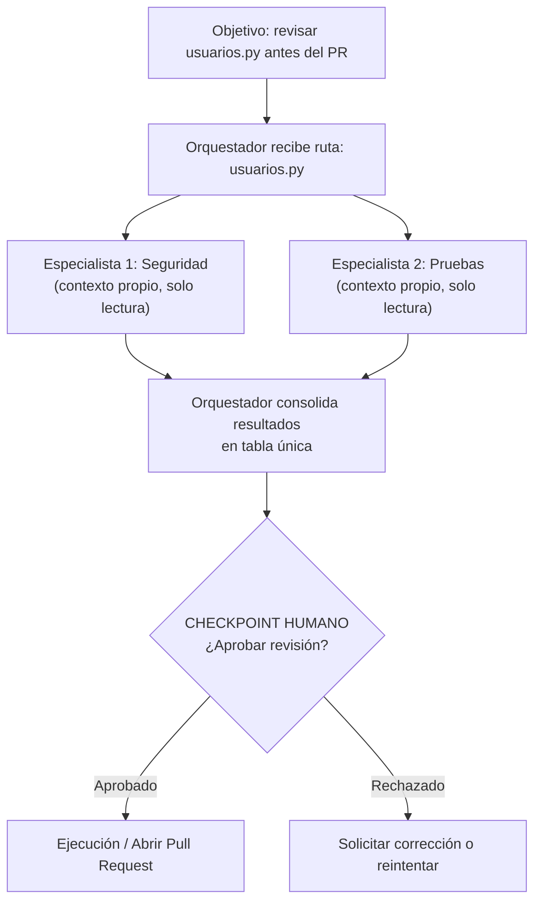
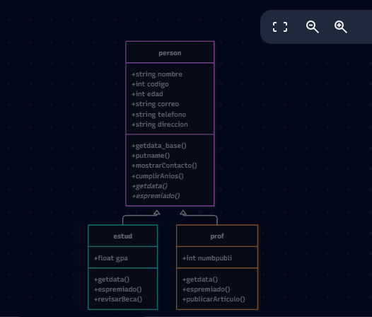
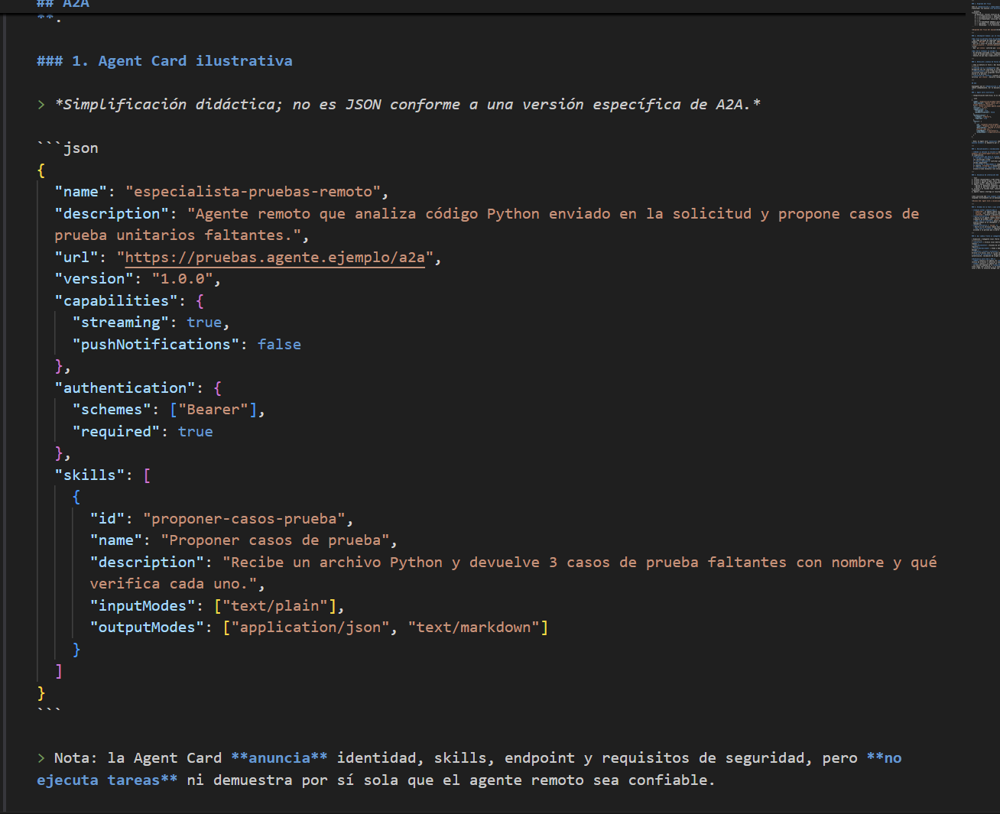

# Equipo de Agentes — Revisión previa a Pull Request (`usuarios.py`)

## Parte 1 — Diseño del equipo

### Roles y límites

| Agente | Misión | Herramientas autorizadas | Entrada | Salida | Límites |
|---|---|---|---|---|---|
| **Orquestador** | Repartir la revisión de `usuarios.py` entre los especialistas y consolidar sus resultados | Ninguna propia (solo delega) | Ruta del archivo: `usuarios.py` | Tabla consolidada con hallazgos de seguridad y casos de prueba propuestos | No modifica `usuarios.py` ni otros archivos; no inventa resultados |
| **Especialista 1 — Seguridad** | Buscar claves o tokens escritos en el código y entradas de usuario sin validar en `usuarios.py` | `read_file`, `grep_search` (solo lectura y búsqueda) | Ruta del archivo: `usuarios.py` | Lista con: línea, problema y severidad | Solo revisa `usuarios.py`; no escribe ni edita archivos |
| **Especialista 2 — Pruebas** | Proponer 3 casos de prueba faltantes para las funciones de `usuarios.py` | `read_file` (solo lectura) | Ruta del archivo: `usuarios.py` | Lista con: nombre del caso y qué verifica | Solo propone; no escribe archivos de pruebas |

---

### 1. Diagrama del flujo

Como el **Especialista 1 (Seguridad)** y el **Especialista 2 (Pruebas)** no dependen uno del otro, el orquestador los ejecuta **en paralelo** y consolida sus salidas antes del **checkpoint humano**:





---

### 2. Checkpoint humano: qué se revisa antes de aprobar o rechazar

**Qué mira la persona antes de aprobar:**
- Que cada hallazgo de seguridad coincida con el número de línea y el código real de `usuarios.py` (por ejemplo, `API_KEY` en línea 10, `ADMIN_PASSWORD` en línea 11 o la concatenación SQL en la línea 21).
- Que los 3 casos de prueba propuestos correspondan a funciones reales de `usuarios.py` (`buscar_usuario`, `calcular_descuento`, `crear_usuario`, `es_admin`) y verifiquen comportamientos útiles.
- Que `git status` confirme que `usuarios.py` **no** fue modificado por ningún agente.

**Qué haría rechazar la salida:**
- Un hallazgo alucinado (línea inexistente o código que no está en `usuarios.py`).
- Casos de prueba genéricos, repetidos o sin relación con las funciones del archivo.
- Señales de que algún especialista intentó escribir archivos o excedió su alcance.

---

### 3. Detección y manejo de fallos de un especialista

| Cómo se detecta el fallo | Qué hace el orquestador |
|---|---|
| **Salida vacía o incompleta** (por ejemplo, menos de 3 pruebas o sin severidad/línea) | Reintenta la delegación una vez indicando el formato esperado. Si persiste, avisa a la persona en el checkpoint. |
| **Alucinación** (cita líneas que no existen en `usuarios.py` o funciones inventadas) | Pide corrección explícita exigiendo lectura literal del archivo; si vuelve a fallar, descarta el ítem y alerta a la persona. |
| **Violación de límites** (intenta modificar `usuarios.py` o leer otros archivos) | Detiene el flujo, verifica `git status`, descarta cualquier cambio no autorizado y reporta el incidente a la persona. |

---

## A2A

Supongamos que el **Especialista 2 (Pruebas)** ahora pertenece a otro equipo y corre en un servidor remoto independiente. Así lo descubriría y delegaría nuestro orquestador usando **A2A (Agent-to-Agent)**.

### 1. Agent Card ilustrativa

> *Simplificación didáctica; no es JSON conforme a una versión específica de A2A.*

```json
{
  "name": "especialista-pruebas-remoto",
  "description": "Agente remoto que analiza código Python enviado en la solicitud y propone casos de prueba unitarios faltantes.",
  "url": "https://pruebas.agente.ejemplo/a2a",
  "version": "1.0.0",
  "capabilities": {
    "streaming": true,
    "pushNotifications": false
  },
  "authentication": {
    "schemes": ["Bearer"],
    "required": true
  },
  "skills": [
    {
      "id": "proponer-casos-prueba",
      "name": "Proponer casos de prueba",
      "description": "Recibe un archivo Python y devuelve 3 casos de prueba faltantes con nombre y qué verifica cada uno.",
      "inputModes": ["text/plain"],
      "outputModes": ["application/json", "text/markdown"]
    }
  ]
}
```

> Nota: la Agent Card **anuncia** identidad, skills, endpoint y requisitos de seguridad, pero **no ejecuta tareas** ni demuestra por sí sola que el agente remoto sea confiable.

---

### 2. Descubrimiento y validaciones del cliente

- **Dónde se obtiene la tarjeta:** desde una URL conocida del servidor remoto (`https://pruebas.agente.ejemplo/.well-known/agent-card.json`) o mediante un registro interno/catálogo de agentes aprobados por la organización.
- **Validaciones que hace el cliente (orquestador) antes de delegar:**
  1. **Origen y transporte:** verificar que el dominio (`agente.ejemplo`) esté permitido y use HTTPS con certificado válido.
  2. **Skill adecuada:** confirmar que exista la skill `proponer-casos-prueba` con modos de entrada/salida compatibles.
  3. **Interfaz y capacidades:** comprobar la URL del endpoint (`https://pruebas.agente.ejemplo/a2a`) y si soporta `streaming` o respuestas síncronas.
  4. **Autenticación requerida:** validar que el cliente cuenta con un token `Bearer` autorizado con el alcance mínimo necesario (sin enviar secretos propios en el cuerpo).

---

### 3. Secuencia de interacción A2A

```text
1. Cliente (Orquestador) → GET https://pruebas.agente.ejemplo/.well-known/agent-card.json
2. Cliente → Valida origen, skill "proponer-casos-prueba", interfaz y esquema Bearer
3. Cliente → POST /a2a (envía mensaje con el contenido/contexto necesario de usuarios.py + token Bearer)
4. Agente remoto → Puede devolver:
   - Opción A: Respuesta inmediata con un mensaje (si termina rápido, sin crear Task)
   - Opción B: Una Task creada (ej. estado "submitted" → "working")
5. Cliente → Si recibió Task, consulta estado (polling) o escucha actualizaciones (streaming) hasta "completed"
6. Agente remoto → Entrega el resultado final (Artifact con los 3 casos de prueba propuestos)
```

*(Una solicitud A2A **no siempre crea una Task**: si el trabajo es breve, el agente remoto puede responder directamente con un mensaje.)*



---

### 4. Estados de la Task y caso alternativo

- **Camino normal simplificado:**
  - `submitted`: el agente remoto recibió y aceptó la solicitud.
  - `working`: está analizando el código y generando los 3 casos de prueba.
  - `completed`: terminó y adjuntó el resultado (Artifact) listo para consolidar.
- **Caso alternativo — `input-required`:**
  - Ocurre si el agente remoto necesita información faltante (por ejemplo, qué versión de Python o framework de pruebas usar: `pytest` o `unittest`).
  - **Qué hace el cliente:** pausa la espera, revisa si tiene ese dato en el contexto o consulta al usuario humano en un checkpoint, y envía un nuevo mensaje en la misma Task con la aclaración para reanudarla.
- **Caso alternativo — `failed`:**
  - Ocurre si el análisis remoto falla (error interno, timeout o entrada rechazada).
  - **Qué hace el cliente:** registra el error, decide si reintenta con backoff o degrada elegantemente avisando a la persona que la parte de pruebas debe revisarse manualmente.

---

### 5. Qué cambia frente al subagente local (y diferencia con MCP)

| Dimensión | Subagente local (Parte 2) | Agente remoto A2A (Parte 3) |
|---|---|---|
| **Interfaz** | Archivo local dentro del harness (`.gemini/agents/`) | Red (HTTPS/JSON sobre endpoint remoto) |
| **Descubrimiento** | Escaneo de carpeta local / `/agents` | `/.well-known/agent-card.json` o registro |
| **Interoperabilidad** | Atado a Gemini CLI | Estándar abierto entre agentes de distintos frameworks/equipos |
| **Permisos y acceso a archivos** | Comparte disco local (herramientas `read_file`) | No tiene acceso directo a tu disco; solo ve lo que le envías |
| **Límites de confianza** | Mismo entorno del usuario | Frontera de red y organización: requiere autenticación, validación de origen y minimización de datos |

**Diferencia entre A2A y MCP:**
- **MCP** conecta a un agente con **herramientas y recursos** (por ejemplo, un servidor MCP que expone lectura de archivos o consultas a una base de datos).
- **A2A** conecta a un agente con **otro agente autónomo** que razona y ejecuta tareas por su cuenta.
- La elección depende de la **arquitectura y la interfaz de comunicación**, **no** de que la tarea trate sobre leer archivos: si el orquestador solo necesita leer un archivo o dato, usa una herramienta local o MCP; si necesita delegar una revisión autónoma a otro equipo o servicio inteligente, usa A2A.

