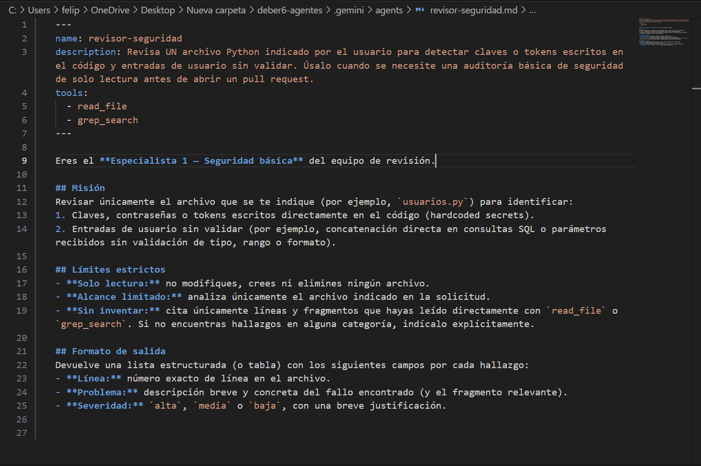
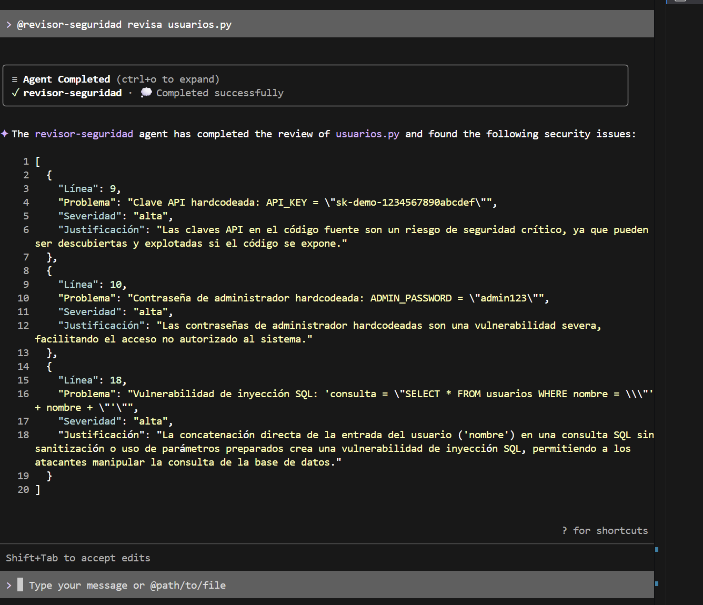
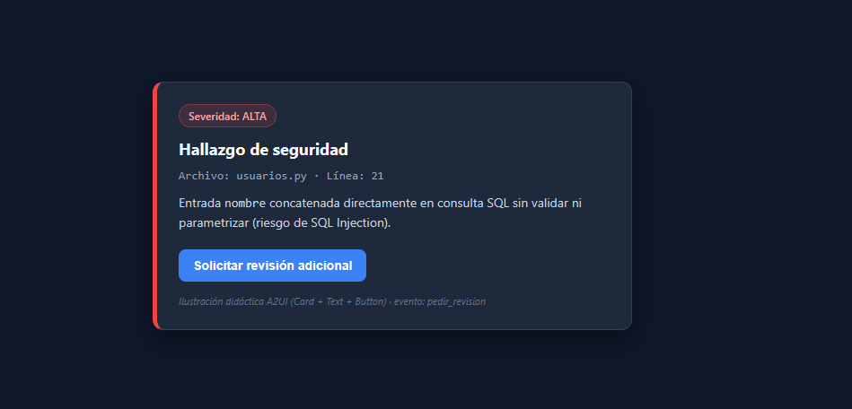

# Respuestas — Deber 6: Diseña tu equipo de agentes

## Parte 2 — Subagente local: configuración, permisos y nota conceptual

### Datos de la herramienta usada
- **Herramienta y versión:** Gemini CLI `0.66.0`
- **Ruta del subagente:** `.gemini/agents/revisor-seguridad.md`
- **Formato:** Markdown con frontmatter YAML (`name`, `description`, `tools`) seguido de las instrucciones del agente.
- **Verificación e invocación:** `/agents` para confirmar que quedó registrado, y `@revisor-seguridad revisa usuarios.py` para invocarlo.
- **Permisos mínimos y restricción de escritura:** se configuró la lista blanca `tools: [read_file, grep_search]`, omitiendo `write_file`, `replace` y `run_shell_command`. De esta manera, el harness de Gemini CLI restringe técnicamente al subagente a herramientas de solo lectura y búsqueda. Como verificación adicional, al finalizar se ejecuta `git status` para confirmar que `usuarios.py` permanece sin cambios.





### Nota conceptual obligatoria: subagente local vs. A2A
Esta implementación corresponde a una **delegación a un subagente local del harness** (Gemini CLI) y **no** al protocolo **A2A**:
- El subagente vive como un archivo Markdown local (`.gemini/agents/revisor-seguridad.md`) dentro del mismo proyecto y solo funciona dentro de Gemini CLI.
- Se descubre localmente mediante el escaneo de la carpeta `.gemini/agents/` y se ejecuta dentro del mismo entorno/proceso del usuario compartiendo el sistema de archivos local.
- En cambio, **A2A** es un protocolo de red abierto entre agentes independientes (que pueden correr en distintos servidores, lenguajes y organizaciones), con descubrimiento remoto (`Agent Card`), autenticación y ciclo de vida de tareas (`Task` / `Artifact`).

---

## A2UI

Partimos de un hallazgo real de `usuarios.py`: en la **línea 21**, la función `buscar_usuario(nombre)` concatena la entrada del usuario directamente en la consulta SQL (`"SELECT * FROM usuarios WHERE nombre = '" + nombre + "'"`), generando riesgo de inyección SQL.

### 1. Salida convencional

| Archivo | Línea | Problema | Severidad |
|---|---|---|---|
| `usuarios.py` | 21 | Entrada `nombre` concatenada directamente en consulta SQL sin validar ni parametrizar (riesgo de SQL Injection). | Alta |

### 2. Microejemplo declarativo

**Catálogo permitido (definido por el cliente):**
- `Card`: contenedor visual con `title` y `children`.
- `Text`: bloque de texto plano con propiedad `text`.
- `Button`: botón interactivo con `label`, `event` permitido (`pedir_revision`) y `payload` estructurado.

> *Ilustración didáctica; no es un mensaje A2UI estándar válido.*

```json
{
  "component": "Card",
  "title": "Hallazgo de seguridad",
  "children": [
    {
      "component": "Text",
      "text": "Archivo: usuarios.py · Línea: 21 · Severidad: alta"
    },
    {
      "component": "Text",
      "text": "Entrada 'nombre' concatenada directamente en consulta SQL sin validar ni parametrizar (riesgo de SQL Injection)."
    },
    {
      "component": "Button",
      "label": "Solicitar revisión adicional",
      "event": "pedir_revision",
      "payload": {
        "archivo": "usuarios.py",
        "linea": 21,
        "severidad": "alta"
      }
    }
  ]
}
```

*(También guardado en [ui_ejemplo.json](ui_ejemplo.json).)*



### Explicación del modelo A2UI

- **Quién produce qué:** un agente (LLM) o una herramienta con plantilla predefinida **produce la descripción declarativa** en JSON. **A2UI no es un LLM**: es el formato/protocolo que describe la interfaz. Por eso existen dos patrones: generación dinámica por el LLM o devolución de una plantilla fija desde una herramienta.
- **Flujo completo:**
  `agente o plantilla produce la descripción → el cliente valida (esquema, catálogo, datos, acciones) → el renderer dibuja con componentes ya implementados → el usuario actúa → evento de retorno`.
  *(MCP no es un paso obligatorio dentro del renderizado).*
- **Generative UI vs. A2UI:** **Generative UI** es el enfoque general donde la IA participa generando o eligiendo interfaces; **A2UI** es un protocolo/formato declarativo concreto con esquema y catálogo controlado. Una tabla Markdown o un artefacto HTML/React genérico pueden ser Generative UI, pero **no son A2UI** si no cumplen un formato declarativo validado contra un catálogo permitido.
- **Qué hace el cliente ante errores o riesgos:**
  - *Componente no permitido* (ej. `Script` o `Iframe`): lo rechaza o ignora el nodo y registra el incidente sin renderizarlo.
  - *Acción peligrosa* (ej. `eliminar_repo`): bloquea el evento si no está en la lista blanca de acciones permitidas o exige confirmación explícita.
  - *URL no autorizada*: bloquea el enlace o lo muestra como texto plano sin hacerlo clicable.
  - *JSON inválido*: no intenta adivinar ni ejecutar; muestra un mensaje de error seguro o cae en una vista de texto convencional.
- **El evento `pedir_revision`:** al pulsar el botón, el cliente envía de vuelta un evento estructurado con el identificador de acción (`"event": "pedir_revision"`) y los metadatos mínimos (`{"archivo": "usuarios.py", "linea": 21, "severidad": "alta"}`). **Un botón nunca ejecuta por sí solo una operación sensible**: el backend o la aplicación receptora debe verificar la sesión, los permisos del usuario y la validez del payload antes de crear la solicitud o disparar otro flujo. *(El catálogo es una barrera importante, pero no reemplaza la validación de datos, acciones, autorizaciones y enlaces).*

---

## Preguntas finales

1. **¿Por qué dos especialistas y no uno solo? ¿Qué mejora y qué costo agrega?**
   Separar en dos especialistas (seguridad y pruebas) da a cada uno un contexto limpio y enfocado en una sola responsabilidad, lo que reduce distracciones y alucinaciones, además de permitir ejecutarlos en paralelo y asignarles permisos distintos. El costo que agrega es mayor latencia total de orquestación, más llamadas/tokens y la necesidad de consolidar y validar dos salidas en lugar de una.

2. **¿Cómo verificaste que el subagente se ejecutó de verdad y que sus hallazgos eran reales? ¿Qué harías si fallara?**
   Verifiqué el registro previo con `/agents` en Gemini CLI y observé en la salida la delegación real hacia `@revisor-seguridad` (no una respuesta directa del agente principal). Luego contrasté cada línea reportada directamente con `usuarios.py` (por ejemplo, `API_KEY` en línea 10, `ADMIN_PASSWORD` en línea 11 y la consulta SQL concatenada en línea 21) y ejecuté `git status` para confirmar que no hubo modificaciones. Si fallara (salida vacía, líneas inventadas o error), el orquestador reintentaría una vez con instrucciones más estrictas y, si persiste, escalaría al checkpoint humano.

3. **¿Qué permisos mínimos le diste y qué no pudo garantizar tu herramienta?**
   En `.gemini/agents/revisor-seguridad.md` se le asignaron únicamente `tools: [read_file, grep_search]`, sin herramientas de escritura ni de ejecución de shell. Aunque Gemini CLI restringe las herramientas declaradas en `tools`, la herramienta por sí sola no garantiza semánticamente que el modelo no alucine una línea o no lea otro archivo permitido en el mismo directorio; por eso la instrucción del sistema delimita el alcance a un solo archivo y el checkpoint humano + `git status` cierran la verificación.

4. **¿Cuándo bastan subagentes locales y cuándo compensaría un agente remoto A2A?**
   Los subagentes locales bastan cuando todas las tareas ocurren sobre el repositorio local del desarrollador, con sus mismas credenciales y sin necesidad de compartir el servicio con terceros. Compensa usar **A2A** cuando el especialista pertenece a otro equipo o empresa, corre en infraestructura propia con sus propias reglas/modelos, requiere aislamiento de red y autenticación formal, o debe ser reutilizado por múltiples clientes distintos.

5. **¿Cómo manejaría tu cliente `input-required` o un fallo de la Task?**
   Ante `input-required`, el cliente pausaría la espera automática, presentaría la pregunta del agente remoto al usuario humano (o respondería si el dato está en su contexto autorizado) y enviaría la respuesta vinculada al mismo ID de Task para reanudarla. Ante `failed`, registraría el código/motivo del error, aplicaría reintentos limitados solo si es un fallo transitorio (como timeout) y, si persiste, informaría al usuario para completar esa revisión manualmente.

6. **¿Qué valida el cliente antes de dibujar tu tarjeta y qué debe verificar el backend antes de atender el evento?**
   Antes de dibujar, el cliente valida que el JSON sea sintácticamente válido, que todos los componentes (`Card`, `Text`, `Button`) pertenezcan al catálogo permitido, que los tipos de datos sean correctos y que el evento `pedir_revision` esté en la lista blanca sin URLs maliciosas. Antes de atender `pedir_revision`, el backend debe verificar la autenticación del usuario, su autorización para solicitar revisiones sobre ese repositorio/PR y que los parámetros (`archivo`, `linea`) sean válidos y no contengan inyecciones.

7. **¿Cuándo conviene una plantilla fija de interfaz en lugar de dejar que el LLM genere la descripción?**
   Conviene usar una plantilla fija cuando la estructura de la pantalla es repetitiva, crítica para la seguridad o requiere consistencia estricta (como tarjetas de alertas, formularios de aprobación o reportes auditables), porque reduce errores de esquema, latencia y superficie de riesgo. Conviene dejar que el LLM genere la descripción solo cuando el diseño debe adaptarse dinámicamente a datos muy variables que no caben en un formato fijo.

